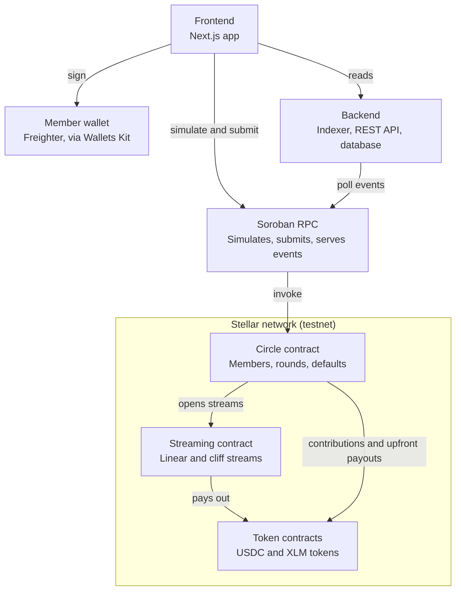

# Pott-stream: Architecture and First Wave Issues

Last updated 27 October 2026. This file is the source of truth for the Pott-stream project. Claude Code and human contributors should read it before starting any issue.

## Overview

Pott-stream is a savings circle on Stellar where each round's pot reaches the winner as a stream instead of one lump sum.

A group of N people each contribute a fixed amount every cycle, and one member wins the pot each round until everyone has won once. In Pott-stream, a configurable share of the pot is paid out immediately and the rest streams to the winner until the circle ends. That unpaid remainder stays locked, so if a winner stops contributing, the group can recover what they owe from it before touching anyone else's money.

Two contracts do the work:

- **Streaming contract:** a standalone engine for linear and cliff streams with cancel. It is useful on its own for payroll and vesting.
- **Circle contract:** manages members, rounds, contributions, collateral and defaults, and pays winners through the streaming contract.

A backend indexes contract events into a REST API, and a Next.js frontend lets members create circles, contribute and withdraw. Everything targets Stellar testnet first and is experimental.

## Positioning

Savings circles and streaming payments both already exist on Stellar, but searches on 27 October 2026 found no project that combines them. Pott-stream's angle is to use streaming as the safety mechanism for a circle.

| Area | Existing Stellar projects found | What they cover |
| --- | --- | --- |
| Savings circles | [Stellar ROSCA](https://github.com/cyberdocs120/stellar-rosca), [AjoChain](https://github.com/BigJohn-dev/AjoChain), [OpenAjo](https://github.com/OGRoute/openajo-app), [Kolo](https://github.com/Stellar-Kolo/kolo-contracts/wiki) | Group creation, contributions, rotating payouts, escrow, some on-chain reputation |
| Streaming and vesting | [TricklePay](https://github.com/TricklePay/docs), [StellarForge](https://github.com/7maylord/stellarforge), [StellarStream](https://github.com/utilityjnr/StellarStream), [Fundable Stellar](https://github.com/divicbold47/stellar_client_os) | Linear and cliff streams, cancel, payroll and vesting |

These links come from search results and the repos were not reviewed in depth, so read them before the Wave opens.

What Pott-stream adds:

- **Streamed payouts as self-collateral:** a winner's unvested remainder covers what they still owe.
- **A collateral formula tied to the upfront share:** each circle sets the upfront share, and the contract computes the collateral required for every position.
- **A reusable streaming engine:** the same contract works for payroll and vesting outside circles.
- **An indexer and dashboard** that show circle and stream state in one place.

## Scope for the first Wave

The first Wave delivers a working testnet system: the streaming contract, the circle contract on top of it, an indexer with an API, and a frontend.

**In scope**

- Streaming contract with linear and cliff vesting, withdraw and cancel.
- Circle contract with join, contribute, settle, collateral and default handling.
- Event indexer and REST API.
- Frontend with wallet connection, circle creation, contributions and a streams dashboard.
- Testnet deployment, tests, and architecture and security docs.

**Out of scope for now**

- Mainnet deployment and audits.
- Fiat on and off ramps, KYC and credit reporting.
- On-chain reputation and random turn order.
- Yield on idle funds.
- Pause and resume for streams, and creator-defined turn order (later batches).

**Defaults chosen**

- One combined project with three repos: contracts, backend and frontend.
- USDC and XLM first, both through Stellar Asset Contracts, with an admin-managed token allowlist.
- Turn order follows join order.
- Testnet only, labeled experimental.

## System architecture



Members sign with their wallet and write straight to the contracts, while the backend only polls events and serves reads. The circle contract opens streams on the streaming contract, and both move funds through token contracts. The work lives in three repos: pott-stream-contracts holds both contracts and their tests, pott-stream-backend holds the indexer and API, and pott-stream-frontend holds the app.

## Streaming contract

The streaming contract holds funds for a recipient and releases them linearly between a start and an end time, with an optional cliff. It is built first because the circle contract depends on it.

**Data model**

| Field | Type | Meaning |
| --- | --- | --- |
| id | u64 | Stream identifier |
| sender | Address | Account that funded the stream (the circle contract for circle payouts) |
| recipient | Address | Account that can withdraw vested funds |
| token | Address | SEP-41 token or Stellar Asset Contract |
| total | i128 | Amount deposited at creation |
| start, cliff, end | u64 | Ledger timestamps in seconds; start ≤ cliff ≤ end |
| withdrawn | i128 | Amount the recipient has already taken |
| cancelable | bool | Whether the sender may cancel |
| controller | Option\<Address\> | Contract allowed to slash unvested funds (set for circle streams) |

**Vesting math**

Vested amount at time t, rounded down so the contract never over-releases:

```latex
\text{vested}(t) = \begin{cases} 0 & t < \text{cliff} \\ \text{total} & t \ge \text{end} \\ \left\lfloor \dfrac{\text{total} \times (t - \text{start})}{\text{end} - \text{start}} \right\rfloor & \text{otherwise} \end{cases}
```

Multiply before dividing, and use checked arithmetic throughout. Amounts stay in i128 with no 256-bit intermediate: `create_stream` rejects any stream where total × (end − start) would overflow i128, with `ArithmeticOverflow`, so `vested` can never overflow later (decision 3, decided).

**Functions**

| Function | Who must authorize | What it does |
| --- | --- | --- |
| `create_stream` | sender | Validates times and amount, pulls total from the sender, stores the stream, returns its id |
| `vested`, `withdrawable` | nobody (read only) | Return vested(now) and vested(now) minus withdrawn |
| `withdraw` | recipient | Sends up to the withdrawable amount to the recipient |
| `cancel` | sender | If cancelable, pays the recipient their unwithdrawn vested share and refunds the rest to the sender |
| `slash_unvested` | controller | Moves part of the unvested balance to the controller and rebases the schedule (see Defaults and collateral) |

**Events**

- `stream_created`, `withdrawn`, `stream_canceled` and `stream_slashed`, each carrying the stream id and amounts so the indexer can rebuild state.

**Invariants to test**

- withdrawn ≤ vested ≤ total at every ledger time.
- Vested never decreases as time moves forward.
- On cancel, recipient payout plus sender refund never exceeds total minus withdrawn.
- The contract's token balance is at least the sum of total minus withdrawn across active streams.

## Circle contract

The circle contract runs one circle through three states: Open (members joining), Active (rounds running) and Completed. A circle that never fills can be canceled before it starts.

**Parameters set at creation:** token, contribution amount (c), cycle length in seconds, grace period in seconds, number of members (n) and upfront share in basis points (u, from 0 to 10,000).

**Functions**

| Function | Who must authorize | What it does |
| --- | --- | --- |
| `create_circle` | creator | Validates parameters and stores the circle |
| `join` | member | Assigns the next position in join order and takes the collateral for that position |
| `start` | creator | Moves a full circle to Active and fixes the round schedule |
| `contribute` | member | Pulls one contribution for the current round |
| `settle_round` | anyone | After the round deadline plus grace, pays the winner or handles defaults |
| `cancel_circle` | creator | Before start only: refunds everything deposited |

**How a round works**

1. Each member contributes c before the round ends. Round r is won by the member in position r.
2. Anyone calls `settle_round` once the grace period has passed. This keeps the circle running without a trusted operator.
3. The pot is the contributions collected, plus any shortfall covered by defaults handling.
4. The winner receives pot × u ÷ 10,000 immediately.
5. The rest is sent to the streaming contract as a stream from settlement time to the end of the circle, with the circle contract as controller.
6. In the final round there is nothing left to owe, so the winner receives the whole pot at once.

**Events:** `circle_created`, `member_joined`, `circle_started`, `contributed`, `round_settled`, `member_defaulted` and `circle_completed`.

Winners keep contributing in later rounds. When the last round is settled, collateral is released to members who did not default.

## Defaults and collateral

A winner who has taken the pot and then stops contributing is the main risk in any circle. Pott-stream covers it in two layers: the winner's unvested stream first, then collateral. This section is a design proposal and must be checked by the model-based test (issue C-19) before the contract is finalized.

**The collateral formula**

Take n members, contribution c, upfront share u (a fraction) and a winner in position p. After winning, that member owes (n − p) more contributions and holds an unvested stream of n × c × (1 − u) that vests linearly to the end of the circle. Right after the payout, the gap between what they owe and what is still locked is c × (n × u − p), and the gap shrinks every round after that. So the required collateral is:

```latex
\text{collateral}(p) = c \times \max\left(1,\; n\,u - p\right)
```

The floor of one contribution covers a single missed round before a member has won. When u ≤ p ÷ n, the unvested stream alone covers every future contribution, so only that floor is needed. In the contract, use basis points and round up.

**Worked example:** 10 members, 100 USDC contribution, pot of 1,000 USDC.

| Position | Upfront share | Paid now | Streamed | Collateral |
| --- | --- | --- | --- | --- |
| 1 | 10% | 100 | 900 | 100 |
| 1 | 50% | 500 | 500 | 400 |
| 3 | 80% | 800 | 200 | 500 |
| 5 | 50% | 500 | 500 | 100 |

Check on the second row: the winner owes 900 more and has 500 locked, so 400 of collateral closes the gap.

**What happens on a missed contribution**

1. When `settle_round` runs, a member who has not paid by the deadline plus grace is marked as defaulted for that round, and the shortfall equals c.
2. The shortfall is covered first from the member's unvested stream through `slash_unvested`, then from their collateral.
3. Slashing never touches vested funds. At time T it fixes the vested amount so far as a base and streams the reduced remainder from T to the end:

```latex
\text{vested}'(t) = \text{base} + \left\lfloor \dfrac{\text{remaining} \times (t - T)}{\text{end} - T} \right\rfloor, \quad \text{remaining} = \text{total} - \text{base} - x
```

4. A defaulted member receives no further payouts. Each later missed round is covered the same way until their locked funds run out.
5. Collateral that was not used is returned when the circle completes.

**Not yet decided:** what happens when locked funds run out, and how to treat a member who defaults before ever winning. Both are listed under open questions.

## Backend

The backend turns contract events into queryable data. It never holds user keys and never signs on a user's behalf. The contracts remain the source of truth, and the backend is a read model.

**Event indexer.** A TypeScript service polls Soroban RPC for events from the circle and streaming contracts and writes them to the database. It stores a cursor so it can resume after a restart, processes each event idempotently by event id, and supports a backfill from a chosen start ledger, since RPC nodes keep only a limited event history.

**Database.** Postgres in deployment and SQLite for local development, with migrations for circles, members, rounds, contributions, defaults and streams.

**REST API**

| Endpoint | Returns |
| --- | --- |
| `GET /circles` | Paginated circles, filterable by status and token |
| `GET /circles/:id` | Circle parameters, members, current round and deadlines |
| `GET /circles/:id/rounds` | Round history with payouts and defaults |
| `GET /members/:address` | Circles and streams for a wallet |
| `GET /streams/:id` | Stream parameters plus computed vested and withdrawable amounts |
| `GET /health` | Indexer lag and database status |

The API computes vested amounts with the same formula as the contract, so the frontend can show a live balance without a transaction. Contribution reminders through webhooks come later.

**Operations.** Configuration through environment variables, structured logs, a health endpoint that reports how many ledgers the indexer is behind, and an OpenAPI spec generated from the route definitions.

## Frontend

A Next.js app lets members run a circle end to end without touching the command line. Reads come from the backend API. Writes go straight to the contracts: the app builds and simulates the transaction, the member signs it in their wallet, and the app submits it and waits for confirmation.

**Wallets.** Connect through Stellar Wallets Kit so Freighter and other wallets work from one picker.

**Screens**

| Screen | What the member does |
| --- | --- |
| Home | Sees their circles and streams, and the next contribution due |
| Create circle | Sets token, contribution, cycle length, members and upfront share, and sees the required collateral per position before confirming |
| Circle detail | Sees members, current round, countdown and each member's status, and can join or contribute |
| Streams | Sees a live vested balance for each stream and withdraws what is available |

**Behavior to get right**

- Show the exact amount and token before every signature request, and show collateral separately from contributions.
- Handle every failure state: rejected signature, simulation error, expired transaction and RPC outage, each with a clear message.
- Keep deadlines in the member's local time, with the UTC time on hover.
- Work on a phone, keep focus order and labels correct for keyboard and screen readers, and label the app experimental and testnet-only.

## Security and threat model

The contracts hold user funds, so they are the part to get right. No server holds keys, and the backend can be wrong without anyone losing money. Nothing here has been audited, and the project stays on testnet until it has been.

| Threat | Mitigation |
| --- | --- |
| A function runs without the right signer | Call `require_auth` on the correct address in every state-changing function, with a test for each unauthorized caller |
| Overflow or rounding that releases too much | Checked arithmetic, round down on payouts, property tests on the invariants |
| Unusual or malicious token contracts | Only tokens on an admin-managed allowlist (Stellar Asset Contracts and SEP-41 tokens) can be used |
| Calls that exceed Soroban resource limits | Cap the number of members per circle and avoid loops over unbounded storage in one call |
| Data expiring from storage | Keep circles and streams in persistent storage, extend TTL on every write and on reads that matter, and test with ledger time advanced past expiry |
| Griefing through the open `settle_round` call | Make settlement idempotent per round, enforce the state machine, and pay the caller nothing in v1 |
| Reliance on wall-clock assumptions | Use ledger timestamps only and size grace periods well above normal ledger timing |
| Wrong streaming contract in a circle | Fix and validate the streaming contract address when the circle contract is initialized |
| A bad upgrade | A Soroban contract can only be upgraded if it exposes an upgrade function, so v1 can be immutable by leaving one out; if upgrades are added, put them behind a timelocked multisig |

**Design rules**

- No referral or recruitment rewards. Fake "susu" schemes that pay for recruiting are a known scam pattern, and [Wikipedia's article](https://en.wikipedia.org/wiki/Susu_(informal_loan_club)) describes them. Pott-stream stays clearly apart.
- Label every screen and doc as experimental and testnet-only.
- Publish SECURITY.md with a way to report vulnerabilities privately.

**Legal note.** Pooled savings products can fall under financial regulation in some countries. This document is not legal advice; get proper advice before any mainnet launch.

## Testing strategy

The streaming and collateral math is the part most likely to hide bugs, so it gets the heaviest testing. Every pull request should keep CI green and add tests for what it changes.

| Layer | What to test | Tools |
| --- | --- | --- |
| Contracts, unit | Each function, each error, each unauthorized caller | soroban-sdk test utilities |
| Contracts, property | Stream invariants over random amounts, durations and withdrawal times | proptest |
| Contracts, model-based | A reference model of a whole circle checked against the contract across rounds, defaults and slashing | proptest with a state machine |
| Contracts, time | TTL extension and restore behavior with ledger time advanced | soroban-sdk ledger controls |
| Backend | Indexer idempotency, cursor resume, API responses, and a run against a local Soroban network | Vitest or Jest, local network |
| Frontend | Create, join and contribute end to end, plus error states | Playwright |

**Invariants for the circle model**

- Funds in equal funds out plus funds held, at every step.
- No member receives more than the pot for their round.
- For every position and upfront share, simulating a default at each round never leaves the group short while the collateral formula holds.
- A defaulted member never receives a later payout.

**CI.** Format, lint and test on every pull request, with a longer nightly run of the property and model tests at a higher case count.

## Roadmap and open questions

Build in this order, and do not start a phase until the previous gate passes.

1. **Streaming contract** (issues C-01 to C-11). Gate: the stream invariants hold under property tests.
2. **Circle contract** (C-12 to C-19). Gate: the model-based test passes for every position, upfront share and default round.
3. **Backend and frontend** (B-01 to B-07, F-01 to F-07), in parallel once contract events are stable.
4. **Hardening and docs** (D-01 to D-03). Gate: a documented testnet deployment and a demo circle run end to end.

**Decisions the maintainer must make**

1. **Locked funds run out.** If a defaulter's unvested stream and collateral are both used up, does the group skip the round, reduce the pot, or draw on a shared reserve?
2. **Default before winning.** The proposal takes the one-contribution collateral floor and removes the member from the rotation. Is that enough, or should every member post more?
3. **Math width. DECIDED.** Keep i128 and use checked arithmetic. `create_stream` rejects any stream where total × (end − start) would overflow i128, with `ArithmeticOverflow`, so `vested` can never overflow later. No 256-bit intermediate.
4. **Member cap.** The right maximum depends on Soroban resource limits; measure it on testnet before fixing a number.
5. **Upgradeability.** Ship immutable contracts, or add an upgrade function behind a timelocked multisig?
6. **Late payments.** Reject contributions after the grace period, or accept them with a penalty?
7. **Fees.** None in v1; decide whether a protocol fee belongs later.
8. **Name and accounts.** Before publishing, confirm the GitHub organization, repository names, domain, npm and crates.io names are free for Pott-stream, check that it is not confusingly close to the existing Potstream, and run a trademark search.
9. **Campaign rules.** Check the new campaign's eligibility rules, whether new repos are required, and how complexity must be labeled.

**Publishing order for issues.** Post the Trivial and Medium issues for the streaming contract, backend and frontend first. Hold the High issues that depend on decisions 1 and 2 (C-10, C-13 to C-17 and C-19) until those are settled, so contributors do not build on a design that is still moving.

## First issue batch

There are 36 issues: 5 Trivial, 23 Medium and 8 High, using the Wave complexity scale. Each row is a title only; when you post an issue, add acceptance criteria and a test requirement. Keep High for work that is genuinely hard, since honest tagging matters in a Wave.

### Contracts (pott-stream-contracts)

| ID | Issue | Complexity | Depends on |
| --- | --- | --- | --- |
| C-01 | Scaffold a Cargo workspace with streaming and circle crates, plus CI for format, lint and test | Trivial | none |
| C-02 | Stream data model, error enum and storage keys | Medium | C-01 |
| C-03 | `create_stream` with time and amount validation and token transfer in | Medium | C-02 |
| C-04 | `vested` and `withdrawable` views with floor rounding and overflow-safe math | Medium | C-02 |
| C-05 | `withdraw` with recipient authorization and partial amounts | Medium | C-03, C-04 |
| C-06 | `cancel` that pays the recipient their vested share and refunds the rest | Medium | C-03, C-04 |
| C-07 | Events for stream created, withdrawn and canceled | Trivial | C-05, C-06 |
| C-08 | Property tests for the stream invariants | Medium | C-04 |
| C-09 | TTL extension for stream and instance entries, with tests that advance ledger time | Medium | C-03 |
| C-10 | Controller role and `slash_unvested` with schedule rebasing | High | C-05, C-06 |
| C-11 | Admin-managed token allowlist | Medium | C-01 |
| C-12 | Circle data model and `create_circle` with parameter validation | Medium | C-01, C-11 |
| C-13 | `join` with position assignment and collateral deposit | High | C-12 |
| C-14 | `start` and `contribute` with round deadlines and grace period | Medium | C-13 |
| C-15 | `settle_round` with upfront payout and streamed remainder | High | C-10, C-14 |
| C-16 | Default handling: cover shortfalls from the unvested stream, then collateral | High | C-15 |
| C-17 | Policy and implementation for members who default before winning | High | C-16 |
| C-18 | Circle completion: collateral release and final accounting | Medium | C-16 |
| C-19 | Model-based fuzz test for fund conservation across rounds and defaults | High | C-17 |

### Backend (pott-stream-backend)

| ID | Issue | Complexity | Depends on |
| --- | --- | --- | --- |
| B-01 | Scaffold a TypeScript service with config, logging and a health endpoint | Trivial | none |
| B-02 | Event indexer with a persisted cursor and a backfill command | Medium | B-01, C-07 |
| B-03 | Database schema and migrations for circles, members, rounds and streams | Medium | B-01 |
| B-04 | REST endpoints for circles with pagination | Medium | B-02, B-03 |
| B-05 | REST endpoints for streams with computed vested amounts | Medium | B-02, B-03 |
| B-06 | Member history by wallet address | Medium | B-04, B-05 |
| B-07 | Integration tests against a local Soroban network | High | B-04, B-05, C-15 |

### Frontend (pott-stream-frontend)

| ID | Issue | Complexity | Depends on |
| --- | --- | --- | --- |
| F-01 | Scaffold a Next.js app with wallet connection through Stellar Wallets Kit | Medium | none |
| F-02 | Create-circle form with a live collateral calculator | Medium | F-01, C-12 |
| F-03 | Circle detail page with members and round countdown | Medium | F-01, B-04 |
| F-04 | Join and contribute flows with simulate, sign, submit and error states | Medium | F-02, F-03, C-14 |
| F-05 | Streams dashboard with live vested balance and withdraw | Medium | F-01, B-05 |
| F-06 | Empty, loading and error states across all pages | Trivial | F-01 |
| F-07 | End-to-end test for create, join and contribute | High | F-04, F-05 |

### Docs and project setup

| ID | Issue | Complexity | Depends on |
| --- | --- | --- | --- |
| D-01 | ARCHITECTURE.md, SECURITY.md and a threat model | Medium | none |
| D-02 | CONTRIBUTING.md and issue templates with complexity guidance | Trivial | none |
| D-03 | Testnet deployment guide and scripts | Medium | C-15, B-02, F-01 |
